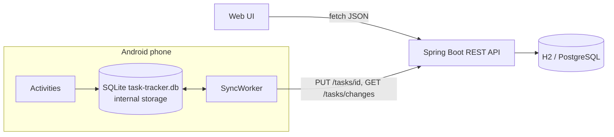

# Task Tracker v1.0.0

Shipped by the Antech `/ship` agent team for CEO Nageshwar.

> Create tasks with a title, notes, due date and priority, mark them done and filter by status - in the browser
> or on Android. The Android app stores everything in the phone's internal storage, works fully offline and
> syncs with the server when you tap **Sync**.

| Part | Technology | Location |
|---|---|---|
| REST API | Java 21, Spring Boot 4.1.2, Spring Data JPA, H2 (dev) / PostgreSQL (prod), springdoc | [`backend/`](backend/) |
| Web UI | Vanilla HTML, CSS, JavaScript (`fetch`) served by the API | [`backend/src/main/resources/static/`](backend/src/main/resources/static/) |
| Android app | Native Java, SQLite in internal storage, `HttpURLConnection` sync | [`android/`](android/) |
| Shipment | Executable JAR + APK | [`dist/`](dist/) and the GitHub Release `task-tracker-v1.0.0` |



## Run it

### Executable JAR (Java 17+ required, 21 recommended)
```bash
java -jar dist/task-tracker-1.0.0.jar
```
Open http://localhost:8080 for the web UI and http://localhost:8080/swagger-ui.html for the API docs.
Data is kept in `./data/` (H2 file database) in the folder you start it from.

### Production (PostgreSQL)
```bash
SPRING_PROFILES_ACTIVE=prod DB_URL=jdbc:postgresql://db:5432/tasks DB_USERNAME=tasks DB_PASSWORD=... \
APP_CORS_ALLOWED_ORIGINS=https://tasks.example.com JPA_DDL_AUTO=update java -jar dist/task-tracker-1.0.0.jar
```

| Variable | Default | Purpose |
|---|---|---|
| `PORT` | `8080` | HTTP port |
| `SPRING_PROFILES_ACTIVE` | `dev` | `dev` = H2 file DB, `prod` = env-configured database |
| `DB_URL`, `DB_USERNAME`, `DB_PASSWORD` | - | Database connection (`prod`) |
| `APP_CORS_ALLOWED_ORIGINS` | `http://localhost:8080` | Comma-separated origins allowed to call the API |
| `JPA_DDL_AUTO` | `update` (dev), `validate` (prod) | Schema management. Use `update` on the first prod start |

### Android APK
Install the APK from the GitHub Release (`task-tracker-1.0.0-debug.apk`, or `task-tracker-1.0.0.apk`
when signing secrets are configured):
```bash
adb install task-tracker-1.0.0-debug.apk
```
Or copy it to the phone and open it (allow "Install unknown apps" for your file manager).
To sync, open the menu, choose **Server URL**, enter your server address, then tap **Sync**. Release builds
require `https://`. Debug builds on the emulator default to `http://10.0.2.2:8080`.

**Where the data lives:** `/data/data/com.antech.tasktracker/databases/task-tracker.db` and private shared
preferences. Only the app can read them. The app requests no storage permission, and Android backup and device
transfer are excluded, so the data stays on the phone until the app is uninstalled.

## Build from source
```bash
cd backend && ./mvnw test && ./mvnw package     # JAR in backend/target/
cd android && gradle wrapper --gradle-version 8.10.2 && ./gradlew testDebugUnitTest assembleDebug
```
The Android build needs the Android SDK (`ANDROID_HOME`). Without it, push a tag `task-tracker-v*`:
GitHub Actions ([`.github/workflows/task-tracker-ci.yml`](../../.github/workflows/task-tracker-ci.yml)) builds
the JAR and APK and attaches them to the release.

## Downloadable documentation
Generated by Scribe in [`dist/docs/`](dist/docs/) and attached to the GitHub Release:

| File | Contents |
|---|---|
| `task-tracker-1.0.0-quickstart.pdf` / `.html` | Step-by-step Quick Start Guide for users |
| `task-tracker-1.0.0-security-report.pdf` / `.html` | Security Report + audit checklist |
| `task-tracker-1.0.0-documentation.pdf` / `.html` | Complete manual: overview, quick start, spec, API, decisions, tests, security |
| `task-tracker-1.0.0-docs.zip` | All of the above plus the Markdown sources |

Rebuild after editing the Markdown:
```bash
python plugins/antech-engineering/skills/ship/scripts/build_docs.py --project projects/task-tracker --name "Task Tracker" --version 1.0.0 --repo-url https://github.com/naddanki87/antechsolutions/blob/main/projects/task-tracker
```

## Documentation
- [docs/QUICKSTART.md](docs/QUICKSTART.md) - step-by-step Quick Start Guide
- [docs/SECURITY-REPORT.md](docs/SECURITY-REPORT.md) - formal security report
- [docs/SPEC.md](docs/SPEC.md) - requirements and acceptance criteria
- [docs/openapi.yaml](docs/openapi.yaml) - API contract; live version at `/v3/api-docs`
- [docs/API.md](docs/API.md) - endpoint reference with `curl` examples
- [docs/SECURITY-AUDIT.md](docs/SECURITY-AUDIT.md) - Armor's audit and sign-off
- [docs/TEST-REPORT.md](docs/TEST-REPORT.md) - Hawk's test results
- [docs/DECISIONS.md](docs/DECISIONS.md) - architecture decisions and agent handoffs
- `.ship/events.jsonl` - the full agent event log, viewable in Antech Mission Control
